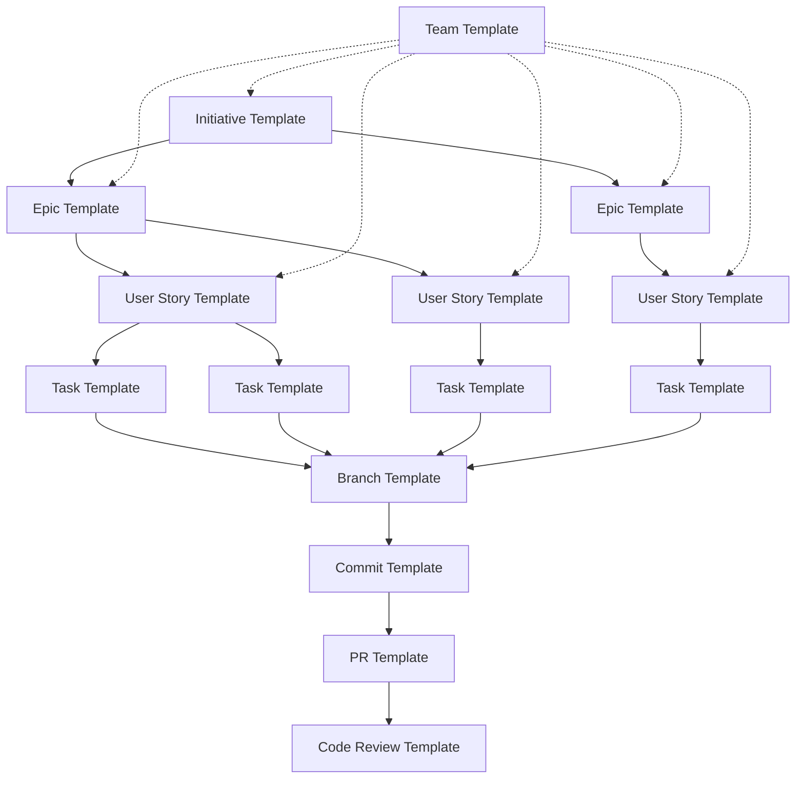

# Project Management Templates

<!-- word-limits: Template Overview=210; Template Categories=190; Template Usage Guidelines=210; Template Customization=130; Best Practices=100; Template Maintenance=70; Getting Help=70; Template Index=330; Template Excellence Categories=120; Implementation Excellence=110; Quality Assurance Framework=80 -->

Standardized formats and checklists for every project management activity, from strategic planning to code delivery.

## Template Overview

### Planning Templates

- **[Initiative Template](initiative-template.md)** - Strategic business initiatives and high-level planning
- **[Epic Template](epic-template.md)** - Large features spanning multiple sprints
- **[User Story Template](user-story-template.md)** - Individual user-focused requirements
- **[Task Template](task-template.md)** - Developer implementation tasks

### Development Templates

- **[Branch Template](branch-template.md)** - Git branch naming and workflow standards
- **[Commit Template](commit-template.md)** - Commit message formats and best practices
- **[Pull Request Template](pr-template.md)** - PR description and review guide
- **[Automation Template](automation-template.md)** - `tech/automation.md` starter: `## Autonomy` `preset: escalate-red` and the preset table
- **[Code Review Template](code-review-template.md)** - Structured code review checklists
- **[Team Template](user-story-template.md)** - Team formation and collaboration guidelines

### Quality, Domain and Operational Templates

- **[Manual Test Case Template](manual-test-case-template.md)** - Manual test case design with version-agnostic variables and priority classification
- **[Manual Test Report Template](manual-test-report-template.md)** - Manual test execution results with sign-off criteria
- **[Context Map Template](context-map-template.md)** - Dispatcher + index + core domain glossary, entities, and common rules, maintained inline (see [Context Map Maintenance](../../architecture/design-patterns/context-map-maintenance.md))
- **[Subdomain Context Template](subdomain-context-template.md)** - Lazy per-subdomain split of the context map, co-located with the subdomain catalog entry
- **[Checkpoint Template](checkpoint-template.md)** - Resumable progress state (story, branch, tasks done, decisions, remaining todos) for context-reset handoffs

## Template Categories

| Template       | Purpose                  | When to Use               | Key Sections                                   |
| -------------- | ------------------------ | ------------------------- | ---------------------------------------------- |
| **Initiative** | Strategic business goals | Quarterly/annual planning | Business case, objectives, success metrics     |
| **Epic**       | Large feature sets       | Sprint planning, roadmap  | Business value, solution approach, timeline    |
| **User Story** | Individual features      | Sprint planning, backlog  | Acceptance criteria, tasks, design specs       |
| **Task**       | Implementation work      | Daily development         | TDD workflow, quality standards, time tracking |
| **Branch**     | Git workflow             | Feature development       | Naming standards, workflow steps               |
| **Commit**     | Code changes             | Every commit              | Message format, TDD patterns, atomic changes   |
| **Pull Request** | Code review            | Feature completion        | Changes, testing, deployment info              |
| **Code Review** | Quality assurance       | PR review process         | Review criteria, feedback guidelines           |
| **Team**       | Team structure           | Team formation            | Roles, responsibilities, collaboration         |

## Template Usage Guidelines

1. **Choose the Right Template:** match your current activity in the tables above
2. **Copy the Template:** use it as a starting point
3. **Customize for Context:** adapt sections and fields to your project
4. **Complete All Sections:** fill every relevant section
5. **Review and Validate:** have stakeholders review the result

### Template Relationships

```text
Initiative (Strategic Level)
├── Epic 1 (Feature Level)
│   ├── User Story 1.1
│   │   ├── Task 1.1.1
│   │   ├── Task 1.1.2
│   │   └── Task 1.1.3
│   └── User Story 1.2
│       ├── Task 1.2.1
│       └── Task 1.2.2
└── Epic 2 (Feature Level)
    └── User Story 2.1
        └── Task 2.1.1
```

Development Flow:

```text
Task → Branch → Commits → Pull Request → Code Review
```

### Quality Standards

- [ ] All required sections filled out; acceptance criteria clearly defined
- [ ] Dependencies and risks identified; testing approach documented; review criteria established
- [ ] Consistent terminology across templates; traceability links maintained between levels
- [ ] Standard formatting and structure followed; team-specific customizations applied

## Template Customization

1. **Add Company Branding:** logo, color schemes, standard headers
2. **Modify Sections:** add, remove, or reorder sections to fit your process
3. **Include Tool Integration:** fields for your tools (Jira, Azure DevOps, etc.)
4. **Update Terminology:** use your organization's terms
5. **Add Compliance Requirements:** regulatory or compliance sections if needed

### Process and Tool Integration

- **Agile/Scrum:** user stories, tasks, sprints. **SAFe:** initiatives, epics, program increments. **Kanban:** continuous flow with stories and tasks. **DevOps:** branch, commit and PR templates for CI/CD.
- **GitHub** (issues, PRs, project boards), **Jira** (stories, epics, tasks), **Azure DevOps** (work items, backlogs), **Linear** (issues, projects), **Trello** (cards, boards).

## Best Practices

1. **Start Early:** begin with templates during planning
2. **Involve Stakeholders:** get input from all relevant team members
3. **Iterate and Improve:** refine templates from team feedback; evolve them from lessons learned
4. **Maintain Traceability:** link related templates and work items
5. **Review Regularly:** keep templates current; peer-review completions, check against team standards, verify completeness and cross-template consistency
6. **Share and Train:** document successful usage patterns; ensure everyone knows how to use templates

## Template Maintenance

- Templates are versioned with the project documentation; changes go through pull requests; history is kept for reference.
- Update process: gather feedback → propose changes (PR) → team review and approval → notify the team → update training.
- Feedback: retrospectives include template effectiveness; anonymous feedback channels; usage analytics for most/least effective templates.

## Getting Help

- **Documentation:** guidance within each template. **Examples:** sample completions for reference. **Team Support:** ask team leads. **Training:** regular sessions on template use.
- Common issues: incomplete templates → use each template's completeness checklist; inconsistent information → cross-reference related templates; process confusion → see the relationship diagram; tool integration → methodology documentation.

---

## Template Index

| File                             | Type           | Use Case                                    | Complexity |
| -------------------------------- | -------------- | ------------------------------------------- | ---------- |
| `initiative-template.md`         | Strategic      | Business planning                           | High       |
| `epic-template.md`               | Feature        | Feature planning                            | Medium     |
| `user-story-template.md`         | Requirement    | Sprint planning                             | Medium     |
| `task-template.md`               | Implementation | Daily development                           | Low        |
| `branch-template.md`             | Development    | Git workflow                                | Low        |
| `commit-template.md`             | Development    | Code commits                                | Low        |
| `pr-template.md`                 | Development    | Code review                                 | Medium     |
| `code-review-template.md`        | Quality        | Review process                              | Medium     |
| `team-template.md`               | Collaboration  | Team formation                              | Medium     |
| `manual-test-case-template.md`   | Quality        | Manual test design                          | Low        |
| `manual-test-report-template.md` | Quality        | Test execution report                       | Low        |
| `context-map-template.md`        | Domain         | Ubiquitous language, entities, common rules | Medium     |
| `subdomain-context-template.md`  | Domain         | Lazy per-subdomain split                    | Low        |
| `checkpoint-template.md`         | Operational    | Resumable progress state                    | Low        |



The **TemplateOrchestrator** manages templates through specialized engines: **TemplateEngine** (creation, versioning, application), **StandardizationEngine** (consistency, quality validation), **WorkflowEngine** (process automation), **CustomizationEngine** (context adaptation, configuration), **GovernanceEngine** (governance, approvals, compliance), **AnalyticsEngine** (usage tracking, effectiveness, optimization).

## Template Excellence Categories

- **Development workflow:** PR templates with review guidance and quality checklists; commit standards; branch naming; issue templates; task breakdown with estimation guidance; feature specification; bug reports with reproduction steps and environment; technical decision templates with criteria and rationale.
- **Project management:** epics with strategic alignment; user stories with acceptance criteria; sprint planning with capacity; retrospectives; status updates; meeting agendas; decision records; escalations.
- **Quality assurance:** code review checklists; testing templates; quality gates; documentation review; incident response; change management; risk assessment; improvement proposals.
- **Stakeholder communication:** client updates, vendor coordination, partnerships, customer support; cross-team communication, leadership reporting, knowledge transfer, training.

## Implementation Excellence

- **Lifecycle:** creation with user research and validation; version control with backward compatibility; approval with stakeholder review; scheduled maintenance. Adoption: onboarding, training, change management, feedback collection.
- **Automation:** context-aware auto-application, integration platforms, validation automation, metrics collection. Customization: context adaptation, team and role-based templates, dynamic content.
- **Effectiveness metrics:** utilization and adoption, quality improvement, user satisfaction, process efficiency. Continuous improvement: optimization, best-practice and feedback integration, innovation adoption.
- **Governance and compliance:** quality standards (accuracy, completeness), consistency enforcement, compliance verification and audit preparation, access control.

## Quality Assurance Framework

- **Template effectiveness:** utilization and adoption tracking, outcome measurement, user-satisfaction feedback, time savings and workflow improvement. Continuous improvement: optimization, best-practice and feedback integration, new-pattern adoption.
- **Governance and compliance:** accuracy and completeness validation, consistency enforcement, regulatory compliance and audit preparation, access control and security.

This framework ensures standardization, workflow automation, and communication consistency across teams.
